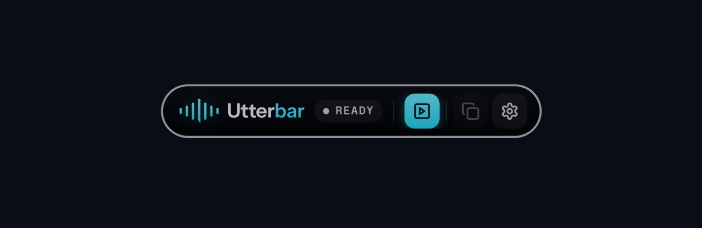
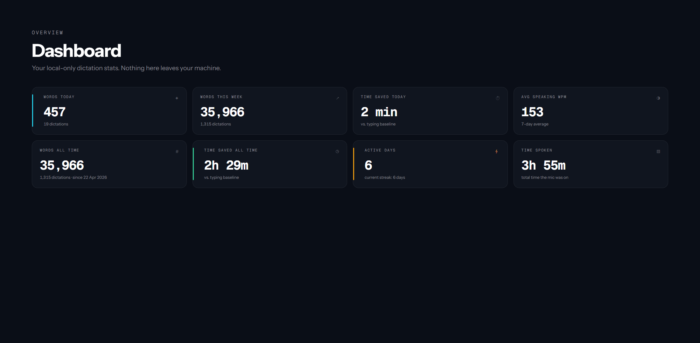

<p align="center">
  
</p>

# Utterbar

### Private dictation for Windows. Speak instead of typing.

Press a hotkey, speak, and put the transcript into the app you are working in.
Speech recognition runs on your PC, not on a transcription server.

**Free and open source. No account, subscription or paid tier.**

[Download for Windows](https://github.com/badoomtch/Utterbar-App/releases/latest)
· [Try the beta](https://github.com/badoomtch/Utterbar-App/releases)
· [Getting started](docs/GETTING_STARTED.md)
· [Report a problem](https://github.com/badoomtch/Utterbar-App/issues/new/choose)
· [Email Jay](mailto:jay@jayparry.me)

GitHub is Utterbar's home for downloads, release notes, documentation and issues.
You do not need a separate website or a GitHub account to download the app.

## Get Started

1. Open the [latest stable release](https://github.com/badoomtch/Utterbar-App/releases/latest).
   Under **Assets**, download `Utterbar_<version>_x64-setup.exe`, not the source-code ZIP.
2. Install it on Windows 10 or 11, then complete onboarding. Choose a microphone
   and download the speech model you want to use.
3. Click into a text field. Press **Ctrl + Space** to start, speak, then press it
   again to stop. Utterbar transcribes and attempts to paste into that field.

Prefer hold-to-talk? Hold **F6** while speaking, then release it. Shortcuts are
configurable in **Settings → Shortcuts**.

> Installers are not code-signed. Windows SmartScreen may show a warning.
> Verify that the installer came from this repository's Releases page before
> deciding whether to run it. GitHub does not make an unsigned executable
> automatically trusted.

## What You Can Do

| Feature                     | What it does                                                                                                                             |
| --------------------------- | ---------------------------------------------------------------------------------------------------------------------------------------- |
| Dictate into other apps     | Send text to editors, browsers and chat boxes with a global hotkey. A manual copy action is available if an app rejects automatic paste. |
| Choose a local speech model | Use NVIDIA Parakeet for English or a multilingual Whisper model. Larger models need more memory and processing time.                     |
| Transcribe meetings         | Capture microphone audio, system audio, or a mix. Meeting mode processes longer recordings in chunks.                                    |
| Transcribe files            | Process recordings, including batches, and export text or subtitle files.                                                                |
| Control the output          | Use voice-to-text, message and meeting presets, or custom modes with local, rule-based formatting. No cloud or LLM rewrite.              |
| Correct recurring mistakes  | Add vocabulary and whole-word replacements for names, acronyms and terms you use.                                                        |
| Keep local history          | Revisit transcripts and optionally retain recordings, with retention controls.                                                           |
| Adjust timing               | Tune end-of-speech capture separately from clipboard restoration.                                                                        |
| Pause media                 | Optionally pause media while recording and restore playback afterwards. Compatibility depends on the media app.                          |
| Mute calls experimentally   | Opt into Teams or Discord mic-mute hotkeys. Check the call app's mute indicator: Utterbar does not read or guarantee its mute state.     |
| Make it yours               | Change theme, accent, floating-bar appearance, accessibility settings and interface language.                                            |

<p align="center">
  
</p>

_Product previews from the project's existing marketing assets. Details can
differ from the installed release._

## Languages

**Speech language and interface language are separate settings.**

- **Dictation:** Parakeet is English-only. Multilingual Whisper models support
  many other languages; choose the appropriate model and dictation language in
  **Settings → Models**. Not every model supports every language.
- **Interface:** English, Español, Français, Deutsch, Italiano, Português and
  Nederlands are selectable in **Settings → General**. Non-English catalogues
  are review translations. Some pages and backend messages still use English.
  Translation corrections are welcome.

See [Getting started](docs/GETTING_STARTED.md) for model selection, timing
settings and everyday use.

## Privacy and Internet Access

Audio and transcript processing stay on your computer. Utterbar does not send
recordings to a cloud recogniser, require an account, or collect telemetry.

Internet access is needed to download speech models and installers. When update
checks are enabled, the app contacts GitHub Releases for version metadata.
External links open your browser or email application. After a model is
installed, dictation works offline; automatic update checks can be disabled.

Local settings, history, models, recordings and logs live under
`%APPDATA%\Utterbar\`. Check recording-retention settings before using sensitive
material. Uninstalling may leave that folder in place.

## Stable and Beta Updates

- **Stable:** use the [latest ordinary release](https://github.com/badoomtch/Utterbar-App/releases/latest).
- **Beta:** builds labelled **Pre-release** are for testing. Browse
  [all releases](https://github.com/badoomtch/Utterbar-App/releases) to choose one.
- Select your channel in **Settings → Updates**. Beta checks include
  prereleases; stable checks exclude them.
- The updater checks the expected installer filename, GitHub's SHA-256 asset
  digest and downloaded byte count before installation.
- Older installations using the retired website updater need one manual
  installation from GitHub to reach the GitHub-based updater.

These links stay current automatically. The separate marketing website is being
retired; use this repository rather than old website download links.

## Requirements

- Windows 10 or Windows 11, **64-bit Intel/AMD**. No macOS, Linux or native ARM
  installer is supplied by this project.
- A microphone for voice input, or system-audio capture for computer playback.
- Microsoft Edge WebView2 Runtime, required by the desktop interface.
- Disk space and memory for your speech model. Start with a smaller model on a
  limited machine. A GPU is not required; acceleration depends on the hardware,
  model and installed runtime.

## Help, Bugs and Feedback

Read [Troubleshooting](docs/TROUBLESHOOTING.md), then
[open an issue](https://github.com/badoomtch/Utterbar-App/issues/new/choose) or
email **[jay@jayparry.me](mailto:jay@jayparry.me)**.

Include your app and Windows versions, selected model, relevant settings,
reproduction steps, and expected versus actual behaviour. For recognition
problems, include the exact words spoken and resulting text if safe to share.
Never post sensitive recordings or unredacted logs publicly.

Report vulnerabilities privately using [SECURITY.md](SECURITY.md).

## Build and Contribute

The desktop uses **Tauri 2, React, TypeScript and Rust**, with local recognition
and SQLite storage. The supported installer requires a Windows build machine.

```powershell
git clone https://github.com/badoomtch/Utterbar-App.git
cd "Utterbar-App/Utterbar Windows App"
pnpm install --frozen-lockfile
pnpm tauri:dev
```

See [Contributing](CONTRIBUTING.md) for prerequisites and checks. Use
`pnpm tauri:build:release` for release bundles so experimental mic-mute support
is included; plain `tauri build` omits that feature.

| Directory                                            | Purpose                                                                          |
| ---------------------------------------------------- | -------------------------------------------------------------------------------- |
| [`Utterbar Windows App/`](Utterbar%20Windows%20App/) | Desktop source, tests, native dependencies and release notes                     |
| [`docs/`](docs/)                                     | User guides and repository images                                                |
| [`Utterbar Website/`](Utterbar%20Website/)           | Legacy Laravel website source, retained for reference; not needed by the updater |

Contributions, bug reports and translation improvements are welcome. Utterbar is
still pre-1.0; follow [Issues](https://github.com/badoomtch/Utterbar-App/issues)
and [release notes](https://github.com/badoomtch/Utterbar-App/releases).

## Licence and Credits

Built by **Jay Parry in Wales**. Utterbar's source is available under the
[MIT Licence](LICENSE), for personal and commercial use.

Bundled libraries and speech models have their own licences. Preserve required
notices and model attributions when redistributing; see
[THIRD_PARTY_NOTICES.md](THIRD_PARTY_NOTICES.md).
